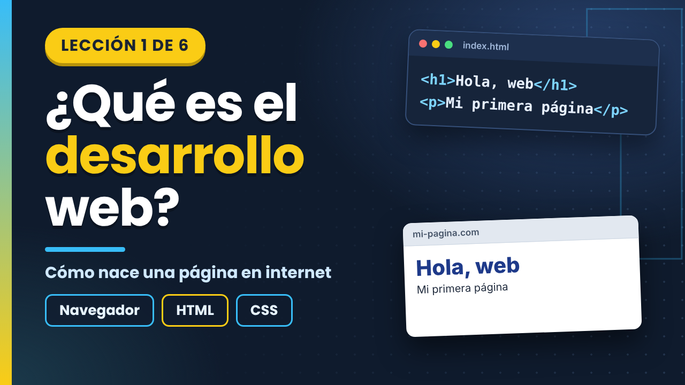
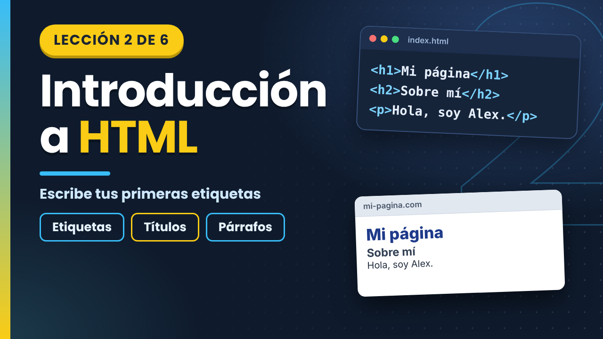
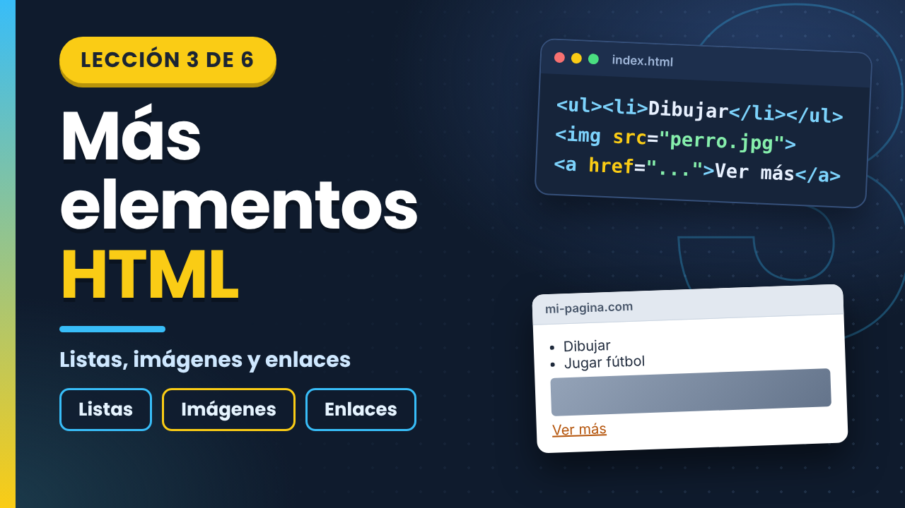
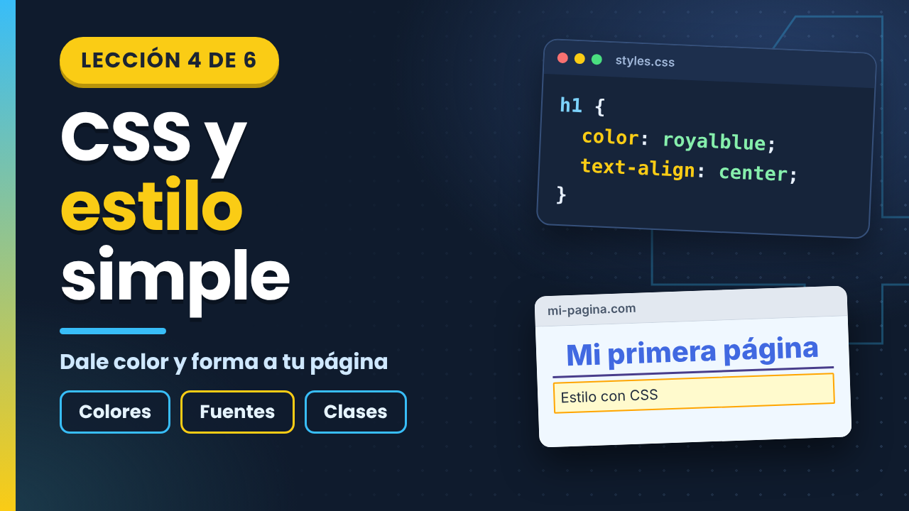
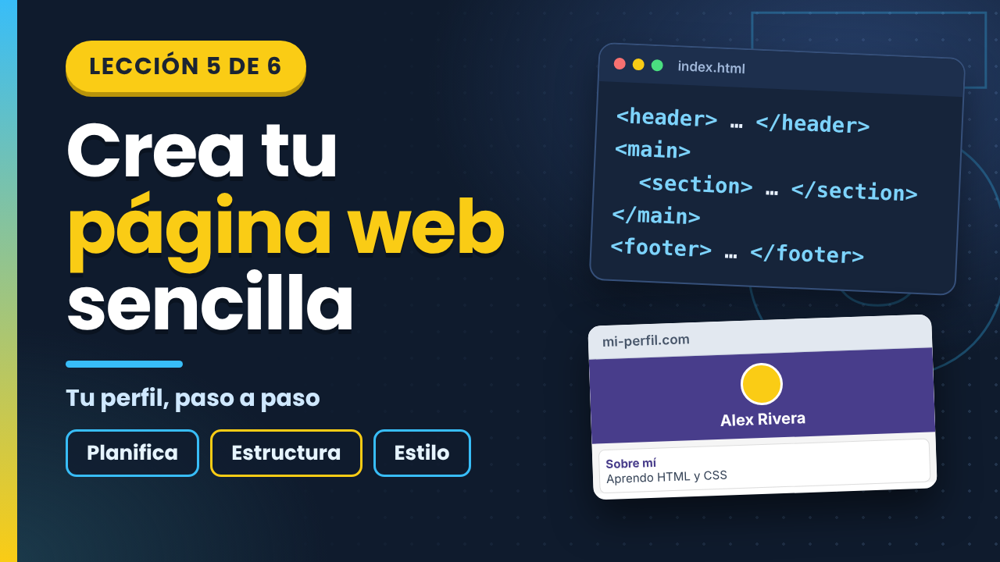
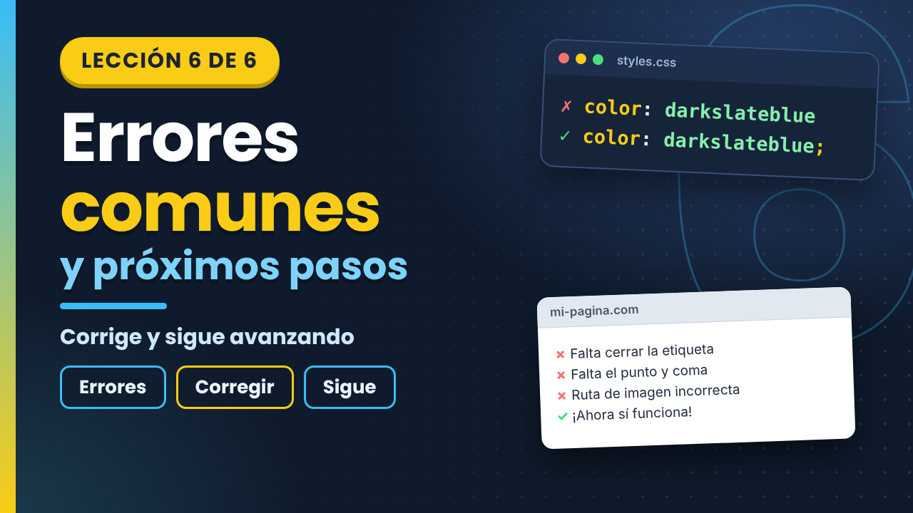

<div align="center">

# 🌐 Curso de HTML y CSS para Principiantes

### Crea tu primera página web, paso a paso. ¡Sin instalar nada!


**📄 [Ver el plan completo del curso](course-plan.md)** · **▶️ [Empezar con la Lección 1](https://www.youtube.com/watch?v=H3NH5MLKntg)**

</div>

---

## 📖 Resumen del Curso

Este curso de aproximadamente 1 hora introduce a estudiantes de secundaria a la creación de sitios web sencillos con HTML y CSS. **¡No requiere descargas!** Solo abre tu navegador web.

| | |
|---|---|
| ⏱️ **Duración total** | 53 minutos y 22 segundos de video, más el tiempo de práctica de cada lección |
| 🎯 **Público objetivo** | Estudiantes de 12 a 17 años sin experiencia en programación |
| 📋 **Prerrequisitos** | Ninguno |
| 🛠️ **Herramientas necesarias** | **¡Solo tu navegador web!** (Chrome, Firefox, Safari, Edge) |
| 💻 **Editor en línea** | [JSFiddle](https://jsfiddle.net/) (gratis y sin registrarte) |
| 📂 **Repositorio de código fuente** | [https://github.com/InventiaStock/webdev-course-inventiastock](https://github.com/InventiaStock/webdev-course-inventiastock) |

> [!TIP]
> En cada lección hay una **pausa para practicar**. Pausa el video, abre el enlace de la práctica y prueba tú mismo. ¡Así se aprende mejor!

## 🎬 Secuencia de lecciones

| # | Lección | Duración | Video | Práctica |
|---|---|---|---|---|
| 1 | ¿Qué es el desarrollo web? | 5 min 13 s | [▶️ Ver](https://www.youtube.com/watch?v=H3NH5MLKntg) | [Starter](https://jsfiddle.net/90peckfs/1/) · [Completed](https://jsfiddle.net/oxnkzsuf/) |
| 2 | Introducción a HTML | 8 min 04 s | [▶️ Ver](https://www.youtube.com/watch?v=s2GweO5BYIA) | [Starter](https://jsfiddle.net/3xv65c7m/) · [Completed](https://jsfiddle.net/3suxkh7v/1/) |
| 3 | Más elementos HTML | 5 min 12 s | [▶️ Ver](https://www.youtube.com/watch?v=stInCQJKZqI) | [Starter](https://jsfiddle.net/curso_web_secundaria/0Lgaq81k/3/) · [Completed](https://jsfiddle.net/curso_web_secundaria/2kLndch8/) |
| 4 | CSS y estilo simple | 11 min 05 s | [▶️ Ver](https://www.youtube.com/watch?v=jGSwjDkOqQM) | [Starter](https://jsfiddle.net/curso_web_secundaria/nuch7dkL/1/) · [Completed](https://jsfiddle.net/curso_web_secundaria/w053u8qd/2/) |
| 5 | Crear una página web sencilla | 12 min 59 s | [▶️ Ver](https://www.youtube.com/watch?v=8NTXde82TQc) | [Starter](https://jsfiddle.net/curso_web_secundaria/yncs5Lht/3/) · [Completed](https://jsfiddle.net/curso_web_secundaria/8h1mknvy/3/) |
| 6 | Errores comunes y próximos pasos | 10 min 49 s | [▶️ Ver](https://www.youtube.com/watch?v=4fsYS1zoavQ) | [Starter](https://jsfiddle.net/curso_web_secundaria/8u3vcsL6/2/) · [Completed](https://jsfiddle.net/curso_web_secundaria/4thz93yn/3/) |

### 🎬 Lección 1: ¿Qué es el desarrollo web?

<p align="center"><a href="https://www.youtube.com/watch?v=H3NH5MLKntg"></a></p>

- ⏱️ **Duración:** 5 min 13 s
- 📝 **Descripción:** Aprende de qué están hechos los sitios web y por qué HTML y CSS son los componentes básicos.
- 📌 **Temas principales:** Qué es un sitio web, HTML y CSS, y cómo usar JSFiddle.
- 💡 **Consejo clave:** Sitios web = Contenido (HTML) + Estilo (CSS).
- ▶️ **Video:** [Ver la lección](https://www.youtube.com/watch?v=H3NH5MLKntg)
- 🟢 **Práctica (Starter):** [https://jsfiddle.net/90peckfs/1/](https://jsfiddle.net/90peckfs/1/)
- 🔵 **Ejemplo resuelto (Completed):** [https://jsfiddle.net/oxnkzsuf/](https://jsfiddle.net/oxnkzsuf/)

### 🎬 Lección 2: Introducción a HTML

<p align="center"><a href="https://www.youtube.com/watch?v=s2GweO5BYIA"></a></p>

- ⏱️ **Duración:** 8 min 04 s
- 📝 **Descripción:** Explora las etiquetas, los elementos y los atributos de HTML, conoce la estructura de una página y crea tu primera página.
- 📌 **Temas principales:** Etiquetas, elementos, atributos, estructura básica, títulos, párrafos y comentarios.
- 💡 **Consejo clave:** Toda etiqueta que se abre, se cierra. Usa `<html>`, `<head>`, `<body>`, `<h1>` y `<p>`.
- ▶️ **Video:** [Ver la lección](https://www.youtube.com/watch?v=s2GweO5BYIA)
- 🟢 **Práctica (Starter):** [https://jsfiddle.net/3xv65c7m/](https://jsfiddle.net/3xv65c7m/)
- 🔵 **Ejemplo resuelto (Completed):** [https://jsfiddle.net/3suxkh7v/1/](https://jsfiddle.net/3suxkh7v/1/)

### 🎬 Lección 3: Más elementos HTML

<p align="center"><a href="https://www.youtube.com/watch?v=stInCQJKZqI"></a></p>

- ⏱️ **Duración:** 5 min 12 s
- 📝 **Descripción:** Agrega listas, imágenes y enlaces para que tu página tenga más contenido.
- 📌 **Temas principales:** Listas, imágenes con `alt` y enlaces.
- 💡 **Consejo clave:** Usa `<ul>`, `<ol>` y `<li>` para listas; `` siempre con `alt`; `<a href>` para enlaces.
- ▶️ **Video:** [Ver la lección](https://www.youtube.com/watch?v=stInCQJKZqI)
- 🟢 **Práctica (Starter):** [https://jsfiddle.net/curso_web_secundaria/0Lgaq81k/3/](https://jsfiddle.net/curso_web_secundaria/0Lgaq81k/3/)
- 🔵 **Ejemplo resuelto (Completed):** [https://jsfiddle.net/curso_web_secundaria/2kLndch8/](https://jsfiddle.net/curso_web_secundaria/2kLndch8/)

### 🎬 Lección 4: CSS y estilo simple

<p align="center"><a href="https://www.youtube.com/watch?v=jGSwjDkOqQM"></a></p>

- ⏱️ **Duración:** 11 min 05 s
- 📝 **Descripción:** Dale estilo a tu HTML con colores, letras, bordes y espacios.
- 📌 **Temas principales:** Reglas de CSS, colores, fuentes, bordes, espacios y clases.
- 💡 **Consejo clave:** Una regla de CSS = selector + propiedad + valor. Las clases se escriben con un punto: `.destacado { ... }`.
- ▶️ **Video:** [Ver la lección](https://www.youtube.com/watch?v=jGSwjDkOqQM)
- 🟢 **Práctica (Starter):** [https://jsfiddle.net/curso_web_secundaria/nuch7dkL/1/](https://jsfiddle.net/curso_web_secundaria/nuch7dkL/1/)
- 🔵 **Ejemplo resuelto (Completed):** [https://jsfiddle.net/curso_web_secundaria/w053u8qd/2/](https://jsfiddle.net/curso_web_secundaria/w053u8qd/2/)

### 🎬 Lección 5: Crear una página web sencilla

<p align="center"><a href="https://www.youtube.com/watch?v=8NTXde82TQc"></a></p>

- ⏱️ **Duración:** 12 min 59 s
- 📝 **Descripción:** Combina HTML y CSS para crear una página de perfil personal y aprende a encontrar errores.
- 📌 **Temas principales:** Planificar y organizar una página con `header`, `main`, `section` y `footer`; crear un perfil.
- 💡 **Consejo clave:** Planea antes de escribir y cambia una sola cosa a la vez.
- ▶️ **Video:** [Ver la lección](https://www.youtube.com/watch?v=8NTXde82TQc)
- 🟢 **Práctica (Starter):** [https://jsfiddle.net/curso_web_secundaria/yncs5Lht/3/](https://jsfiddle.net/curso_web_secundaria/yncs5Lht/3/)
- 🔵 **Ejemplo resuelto (Completed):** [https://jsfiddle.net/curso_web_secundaria/8h1mknvy/3/](https://jsfiddle.net/curso_web_secundaria/8h1mknvy/3/)

### 🎬 Lección 6: Errores comunes y próximos pasos

<p align="center"><a href="https://www.youtube.com/watch?v=4fsYS1zoavQ"></a></p>

- ⏱️ **Duración:** 10 min 49 s
- 📝 **Descripción:** Conoce los cinco errores más comunes, cómo buscarlos con el validador y el inspector, y dónde seguir aprendiendo.
- 📌 **Temas principales:** Cinco errores comunes, validadores, inspector del navegador, buenas prácticas y próximos pasos.
- 💡 **Consejo clave:** Valida tu código y explora la documentación de MDN en español.
- ▶️ **Video:** [Ver la lección](https://www.youtube.com/watch?v=4fsYS1zoavQ)
- 🟢 **Práctica (Starter):** [https://jsfiddle.net/curso_web_secundaria/8u3vcsL6/2/](https://jsfiddle.net/curso_web_secundaria/8u3vcsL6/2/)
- 🔵 **Ejemplo resuelto (Completed):** [https://jsfiddle.net/curso_web_secundaria/4thz93yn/3/](https://jsfiddle.net/curso_web_secundaria/4thz93yn/3/)

---

## 🚀 Cómo utilizar el curso

1. 🎬 Elige una lección y reproduce su video.
2. ⏸️ Cuando el video te lo indique, **pausa** y abre el enlace de la práctica (Starter). También está en la descripción del video.
3. ⌨️ Escribe o completa el código en JSFiddle y presiona **Run** para ver el resultado.
4. 🔍 Si tienes dificultades, abre el ejemplo resuelto (Completed) y compara tu código.

> [!NOTE]
> No necesitas crear una cuenta ni instalar ningún programa para hacer las actividades.

## 🛠️ Configuración

Para seguir el curso **no hay nada que configurar**: solo abre los videos y los enlaces de JSFiddle en tu navegador.

Si quieres explorar los materiales del repositorio en tu computadora, puedes descargarlos con:

```bash
git clone https://github.com/InventiaStock/webdev-course-inventiastock.git
```

## 🗂️ Estructura del repositorio

```text
webdev-course-inventiastock/
│
├── README.md
├── course-plan.md
│
├── assets/
│   └── miniaturas/          # Imágenes de las lecciones
│
├── scripts/                 # Guiones de las lecciones
│   ├── lesson-01.md
│   ├── lesson-02.md
│   ├── lesson-03.md
│   ├── lesson-04.md
│   ├── lesson-05.md
│   └── lesson-06.md
│
├── starter-files/           # Código inicial de cada práctica
│   ├── lesson-01/
│   ├── lesson-02/
│   ├── lesson-03/
│   ├── lesson-04/
│   ├── lesson-05/
│   └── lesson-06/
│
└── completed-examples/      # Ejemplos resueltos
    ├── lesson-01/
    ├── lesson-02/
    ├── lesson-03/
    ├── lesson-04/
    ├── lesson-05/
    └── lesson-06/
```

| Carpeta o archivo | Contenido |
|---|---|
| `scripts/` | Guiones de las seis lecciones |
| `starter-files/` | Código inicial de cada práctica (HTML y, cuando corresponde, CSS) |
| `completed-examples/` | Ejemplos resueltos de cada lección |
| `assets/miniaturas/` | Imágenes de presentación de cada video |
| `course-plan.md` | Plan de aprendizaje completo, con los enlaces a los videos y a las prácticas |

## 📚 Recursos adicionales

- 📖 [Documentación de MDN en español](https://developer.mozilla.org/es/)
- ✅ [Validador de HTML del W3C](https://validator.w3.org/#validate_by_input)
- ✅ [Validador de CSS del W3C](https://jigsaw.w3.org/css-validator/#validate_by_input)
- 💻 [JSFiddle, editor en línea](https://jsfiddle.net/)

---

## 👥 Elaboración

**Universidad Peruana de Ciencias Aplicadas** · Carrera de Ingeniería de Software · Período 202620
**Curso:** 1ASI0730 Aplicaciones Web · **NRC:** 8168

| | |
|---|---|
| **Nombre del equipo** | InventiaStock |
| **Líder del equipo** | Montañez Salinas, Lorena Ariana |
| **Fecha de entrega** | 12 de noviembre de 2026 |

| Integrante | Responsabilidad |
|---|---|
| Vizcarra Mamani, Candy Milagros | Lecciones 1 y 2 |
| Sanchez Osorio, Ruth Yanira | Lección 3 y esqueleto del plan de curso |
| Suarez Chinga, Geraldine | Lección 4 |
| Lopez Rimachi, Sebastian Leonardo | Lección 5 |
| Montañez Salinas, Lorena Ariana | Lección 6, coordinación del equipo e integración final |

El trabajo se gestionó con Git y GitHub, mediante ramas y solicitudes de integración (pull requests). Los aportes de cada integrante están respaldados por el historial de commits del repositorio.

---

<div align="center">

## 🎉 ¡Continúa aprendiendo!

Completar este curso es solo el primer paso. Crea una página sobre una receta, tu club o tu equipo favorito, y cuando te sientas listo, aprende a hacer que tus páginas se vean bien en cualquier pantalla y descubre JavaScript.

**¡Gracias por completar el curso!**

</div>
